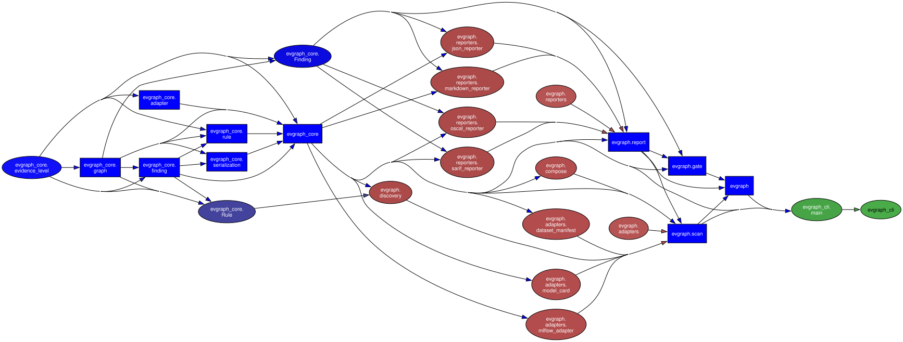
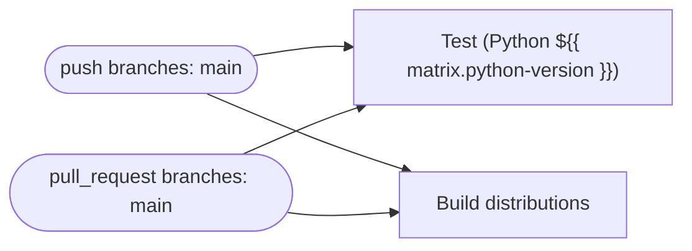
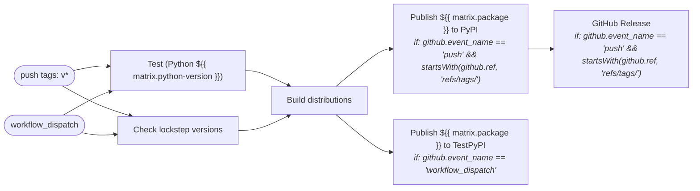
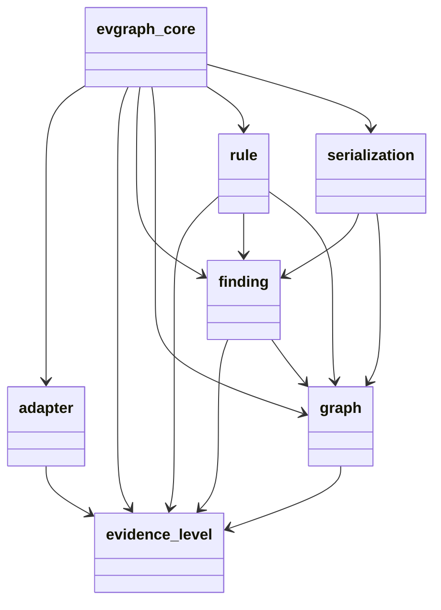
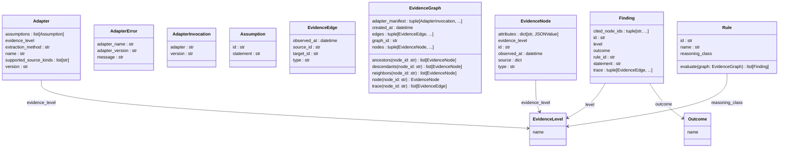
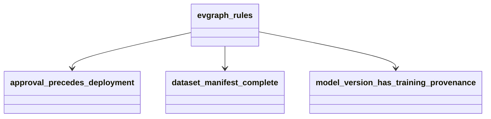
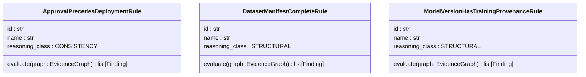
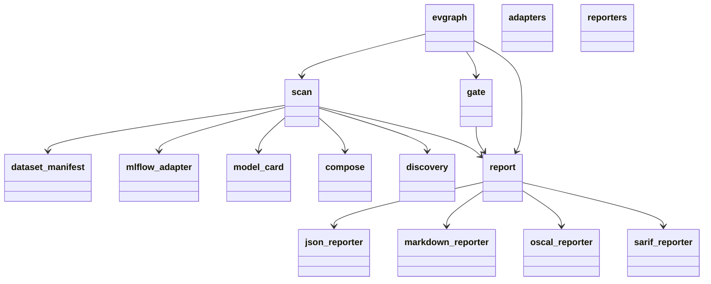
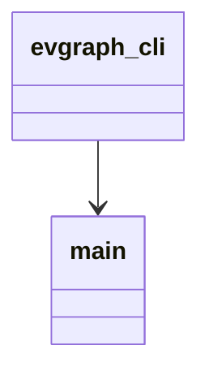

# Diagrams

Generated by `scripts/gen-diagrams.sh` from the source and workflow files.
Do not edit by hand; re-run the script after code or workflow changes.

## Module dependencies

Import graph across all four packages (pydeps). `evgraph_rules` does not
appear because rules are loaded at run time, not imported.

## Call graph

Function-level calls (code2flow): [call-graph.svg](generated/call-graph.svg)

## CI/CD pipelines

### CI (`.github/workflows/ci.yml`)

### Publish (`.github/workflows/publish.yml`)

## `evgraph_core`

### Packages

### Classes

## `evgraph_rules`

### Packages

### Classes

## `evgraph`

### Packages

### Classes

```mermaid
classDiagram
  class DatasetManifestAdapter {
    assumptions : list
    evidence_level : STRUCTURAL
    extraction_method : str
    name : str
    supported_source_kinds : list
    version : str
    scan(artifact: DatasetManifestArtifact) EvidenceGraph
  }
  class DatasetManifestArtifact {
    manifest_path : Path
  }
  class GateResult {
    reasons : tuple[str, ...]
    should_fail : bool
  }
  class MLflowAdapter {
    assumptions : list
    evidence_level : STRUCTURAL
    extraction_method : str
    name : str
    supported_source_kinds : list
    version : str
    scan(client: Any, source: MLflowModelSource) EvidenceGraph
  }
  class MLflowModelSource {
    registered_model_name : str
    version : str | int | None
  }
  class ModelCardAdapter {
    assumptions : list
    evidence_level : STRUCTURAL
    extraction_method : str
    name : str
    supported_source_kinds : list
    version : str
    scan(artifacts: ModelCardArtifacts) EvidenceGraph
  }
  class ModelCardArtifacts {
    approval_path : Path
    deployment_path : Path
    model_card_path : Path
  }
  class NoRulesDiscoveredError {
  }
  class Report {
    findings : tuple[Finding, ...]
    graph : EvidenceGraph
    to_dict() dict
    to_json() str
    to_markdown() str
    to_oscal_assessment_results() str
    to_oscal_assessment_results_dict() dict
    to_sarif() str
    to_sarif_dict() dict
    trace(node_id: str) list[EvidenceEdge]
  }
```

## `evgraph_cli`

### Packages

